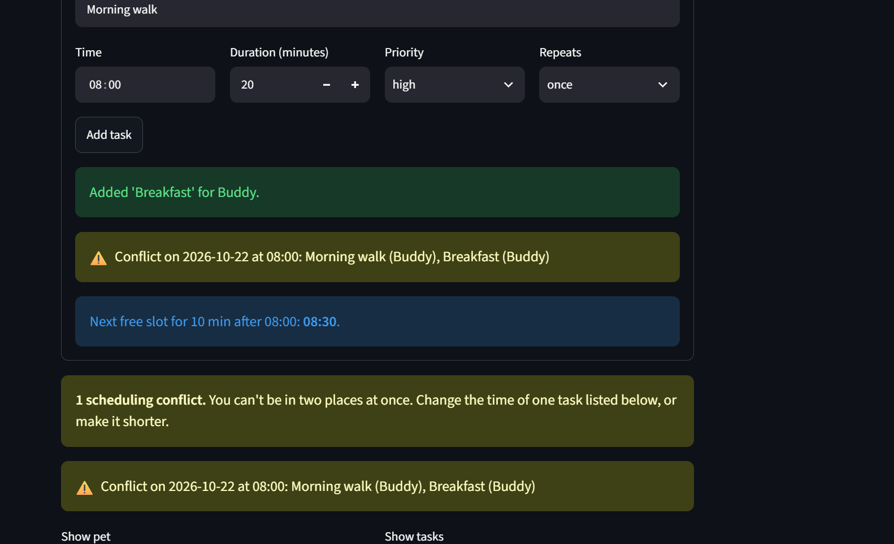
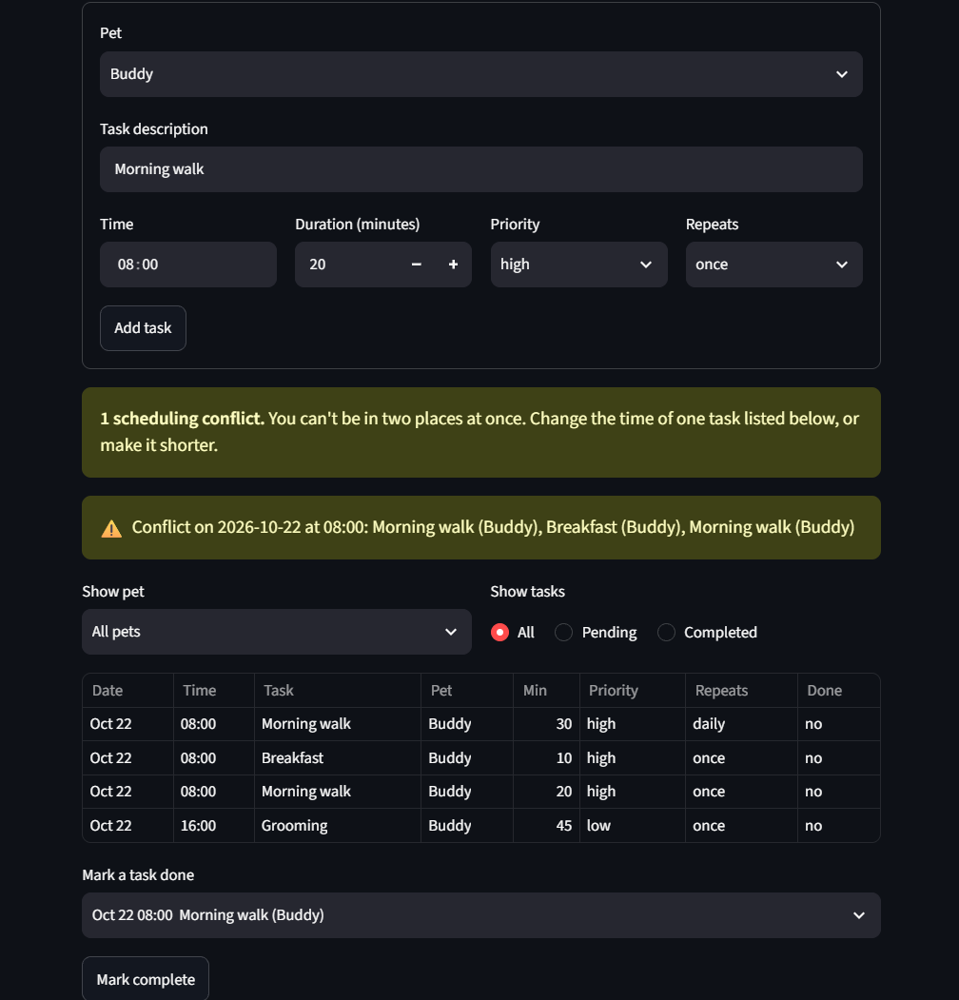
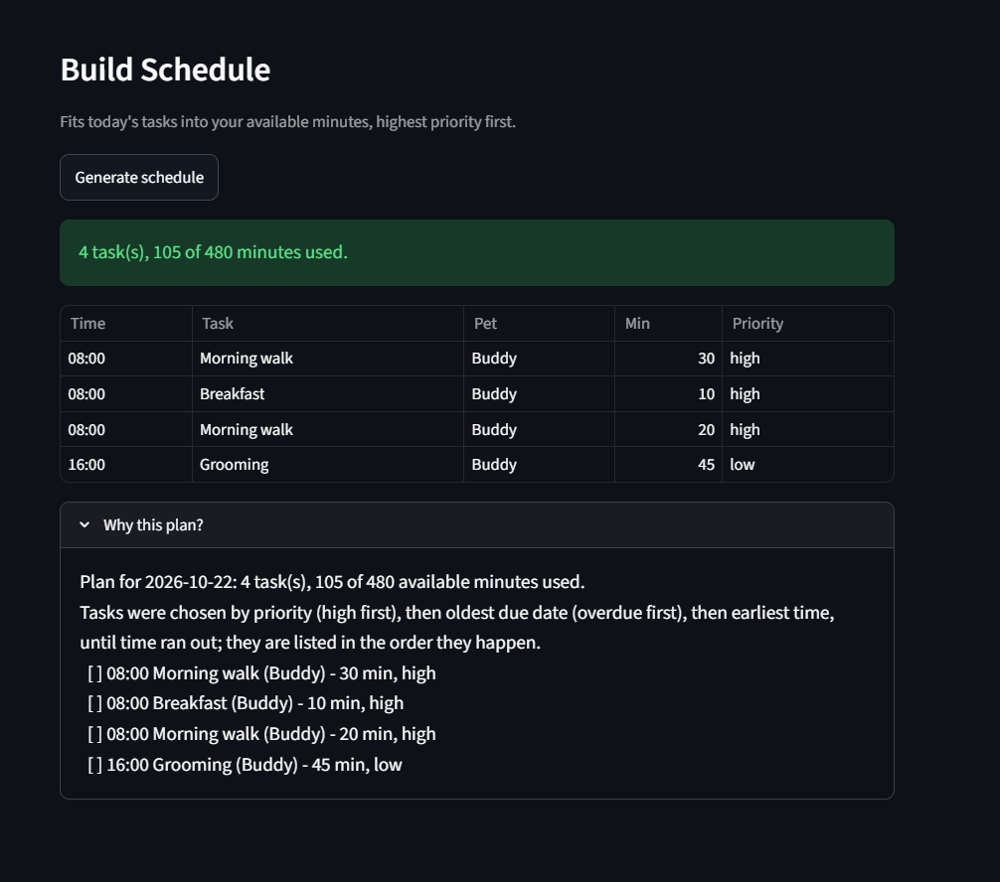
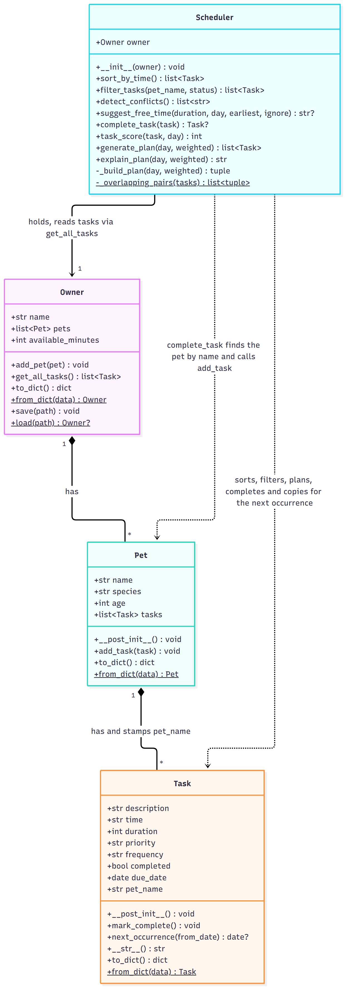

# 🐾 PawPal+

PawPal+ is a pet-care planner for busy owners. Enter your pets and their care tasks (walks, feeding, medication, grooming), and PawPal+ builds a daily plan that fits your available time, puts the most important tasks first, warns you about clashes, and explains every choice it made.

It has two parts: a scheduling engine in plain Python ([`pawpal_system.py`](pawpal_system.py)) and a [Streamlit](https://streamlit.io) web app ([`app.py`](app.py)) on top of it.

## Contents

- [Features](#features)
- [Requirements and installation](#requirements-and-installation)
- [Demo walkthrough](#-demo-walkthrough)
- [How the scheduler decides](#how-the-scheduler-decides)
- [Data persistence](#data-persistence)
- [Architecture](#architecture)
- [Testing](#testing)
- [Project structure](#project-structure)
- [Limitations](#limitations)

## Features

Each feature below names the algorithm behind it, so you know exactly what the app does.

- **Sorting by time.** Tasks from every pet are merged into one list and ordered by due date, then time of day, then priority (high first). Times are stored as zero-padded `HH:MM`, so they sort correctly as text. Ties keep the order the tasks were added.
- **Filtering.** Narrow the list to one pet (whole name, ignoring case) and/or to completed or pending tasks. The engine returns matches in the order tasks were added, and the app then lists them in time order.
- **Conflict warnings.** Two checks run over pending tasks only (completed tasks are ignored):
  - *Same start:* tasks are grouped by date and start time, and any group of two or more gives a `Conflict` warning, even across different pets.
  - *Overlap:* on each day, tasks are ordered by start and each one is compared with the tasks that start after it. If a later task starts before the earlier one ends, you get an `Overlap` warning such as "Long walk 09:00-10:00 runs into Feed at 09:30". A task that ends exactly when the next begins is not a conflict, and a task running past midnight is cut off at 24:00.
- **Free-slot suggestion.** When a task you add clashes, the app walks through that day's pending tasks in start order and returns the first time at or after the task's start where its full duration fits. If nothing fits before midnight, it says so.
- **Daily recurrence.** Completing a daily or weekly task adds the next one to the same pet, dated one or seven days after the *later* of its due date and today, so completing late never schedules into the past. Month ends, year ends and leap days are handled by date arithmetic. One-off tasks create nothing, completing a task twice does nothing, and an identical pending next task is reused instead of duplicated.
- **Daily plan.** Pending tasks due today or earlier (overdue ones stay in) are ranked by priority, then oldest due date, then earliest time, and taken in that order until your available minutes run out. A task that is too long for the time left is skipped so shorter ones can still fit. This is a greedy choice: it favors priority and is not guaranteed to pack the most minutes. The chosen tasks are then shown in the order they happen.
- **Weighted prioritization with aging.** An optional second way to choose the plan. Each task gets a score: priority points (high 10, medium 5, low 2) plus 1 point for every day it is overdue. Tasks are taken highest score first until the minutes run out, so a low-priority task that keeps getting skipped slowly gains points and eventually wins a slot (a low task 5 days overdue scores 7 and beats a medium task due today at 5), while a high-priority task still beats a low one that is only a week late. Ties go to the older due date. Without overdue tasks it gives the same plan as strict priority. Pick it with **Planning style** in the app or `weighted=True` in code.
- **Plan explanation.** The plan states how many of your minutes it uses, which tasks are overdue, and which tasks were left out for lack of time.
- **Saved data.** Pets, tasks, your name and your time budget are saved to `data.json` automatically and loaded the next time you start the app, so nothing is lost between runs. The file is written safely (a crash cannot leave a half-written file) and a damaged or invalid file is never silently overwritten. See [Data persistence](#data-persistence).
- **Input validation.** Tasks reject a time that isn't `HH:MM`, a duration of zero or less, and an unknown priority or repeat setting. An owner rejects a second pet with the same name, ignoring case.

## Requirements and installation

- Python 3.10 or newer
- The packages in [`requirements.txt`](requirements.txt): `streamlit` (the web app) and `pytest` (the tests)

```bash
python -m venv .venv
source .venv/bin/activate      # Windows: .venv\Scripts\activate
pip install -r requirements.txt
```

Start the app from the project root:

```bash
streamlit run app.py
```

Streamlit prints a local address (usually http://localhost:8501) and opens it in your browser.

## 📸 Demo Walkthrough

This walkthrough shows what PawPal+ does, first through the web app and then through the terminal demo. Everything below was run against the code in this repository.

### What you can do in the app

Start it with `streamlit run app.py`. The page is one scrolling screen, top to bottom:

| Area | What you can do |
|------|-----------------|
| **Owner** | Enter your name and the **minutes available today**, which caps the daily plan. |
| **Pets** | Add pets with a name, species (dog, cat, other) and age. A table lists each pet and its task count. Duplicate names are rejected. |
| **Tasks** | Add a task for a pet: description, time, duration (1 to 240 minutes), priority (low, medium, high) and repeat (once, daily, weekly). Invalid input shows an error instead of being saved. |
| **Conflict banner** | Warns about tasks that start together or overlap, and says "No scheduling conflicts." when the day is clear. When a task you just added clashes, it also suggests the next free slot. |
| **Task list** | Shows every pet's tasks sorted by date and time. Filter with **Show pet** and **Show tasks** (All, Pending, Completed). |
| **Mark a task done** | Complete a task. If it repeats, the next one is added automatically. |
| **Saved data** | Everything is saved automatically as you work. An expander at the bottom explains where, and lets you delete all saved data (after ticking a confirmation box). |
| **Build Schedule** | Choose a **Planning style** (strict priority, or priority with aging), then **Generate schedule** to see the tasks that fit in your minutes, in the order they happen, with a **Why this plan?** explanation. |

### Example workflow

Sam has 90 minutes today and two pets.

1. **Set up the owner.** Enter the name `Sam` and set **Minutes available today** to `90`.
2. **Add the pets.** Add `Buddy` (dog) and `Mia` (cat). The pets table shows both with 0 tasks.
3. **Schedule the first task.** For Buddy, add "Morning walk" at 08:00, 30 minutes, high priority, repeating daily. The page confirms it, and no conflict is reported.
4. **Cause a conflict on purpose.** For Mia, add "Breakfast" at 08:00, 10 minutes, high priority. A warning appears right away: `Conflict on 2026-10-22 at 08:00: Morning walk (Buddy), Breakfast (Mia)`, together with `Next free slot for 10 min after 08:00: 08:30.`
5. **Add the rest of the day.** Mia: "Medication" at 12:30, 5 minutes, high. Buddy: "Grooming" at 16:00, 45 minutes, low. Buddy: "Evening walk" at 18:00, 30 minutes, medium. The task list stays in time order however you add them.
6. **Filter the list.** Set **Show pet** to `Mia` to see only Breakfast and Medication, then set it back to **All pets**.
7. **View today's schedule.** Press **Generate schedule**. The result is `4 task(s), 75 of 90 minutes used.`: Morning walk, Breakfast, Medication and Evening walk. Grooming (45 minutes) is left out because only 15 minutes remain, and the **Why this plan?** panel says so.
8. **Complete a recurring task.** Under **Mark a task done**, choose "Morning walk" and press **Mark complete**. The page says the next daily one is due tomorrow, and a new "Morning walk" appears in the list.
9. **Close it and come back.** Stop the app (`Ctrl+C`) and start it again with `streamlit run app.py`. Your pets, tasks, completion status, name and available minutes are all back, because they were saved to `data.json` as you worked.

### Scheduler behaviors on display

| Behavior | Where you see it |
|----------|------------------|
| **Sorting by time** | Step 5: tasks added in any order are listed by date, then time, then priority. |
| **Conflict warnings** | Step 4: two tasks starting at 08:00 trigger a warning, even though they belong to different pets. Overlapping tasks with different start times are flagged too. |
| **Free-slot suggestion** | Step 4: 08:30 is the first time a 10-minute task fits after the 30-minute walk. |
| **Filtering** | Step 6: narrow the list by pet and by completion status. |
| **Priority-based planning** | Step 7: high-priority tasks are chosen first, and the 45-minute low-priority task is the one dropped. |
| **Plan explanation** | Step 7: the panel reports minutes used and lists what was left out. |
| **Weighted prioritization** | Switch **Planning style** to *Priority with aging* in step 7. With no overdue tasks the plan is the same; the terminal demo below shows a case where an overdue low-priority task wins. |
| **Data persistence** | Step 9: pets, tasks, completion status and settings survive a restart. |
| **Daily recurrence** | Step 8: completing a daily task creates the next occurrence on the same pet. Completing it again does nothing. |

### Terminal demo output

[`main.py`](main.py) runs the same engine without the web app. It builds Sam's day from the workflow above, then checks sorting, daily recurrence, late completion, conflict warnings, weighted planning and saving and loading. Run it with:

```bash
python main.py
```

Output:

```
Owner: Sam, 90 minutes available

=== Today's Schedule: Thursday, October 22, 2026 ===
  Date    Time   Task          Pet    Min  Priority  Done
  ------  -----  ------------  -----  ---  --------  ----
  Oct 22  08:00  Morning walk  Buddy   30  high      no
  Oct 22  08:00  Breakfast     Mia     10  high      no
  Oct 22  12:30  Medication    Mia      5  high      no
  Oct 22  18:00  Evening walk  Buddy   30  medium    no

  4 tasks, 75 of 90 minutes used

All tasks, sorted by time:
  Date    Time   Task          Pet    Min  Priority  Done
  ------  -----  ------------  -----  ---  --------  ----
  Oct 22  08:00  Morning walk  Buddy   30  high      no
  Oct 22  08:00  Breakfast     Mia     10  high      no
  Oct 22  12:30  Medication    Mia      5  high      no
  Oct 22  16:00  Grooming      Buddy   45  low       no
  Oct 22  18:00  Evening walk  Buddy   30  medium    no

Conflicts:
  Conflict on 2026-10-22 at 08:00: Morning walk (Buddy), Breakfast (Mia)

Plan for 2026-10-22: 4 task(s), 75 of 90 available minutes used.
Tasks were chosen by priority (high first), then oldest due date (overdue first), then earliest time, until time ran out; they are listed in the order they happen.
  [ ] 08:00 Morning walk (Buddy) - 30 min, high
  [ ] 08:00 Breakfast (Mia) - 10 min, high
  [ ] 12:30 Medication (Mia) - 5 min, high
  [ ] 18:00 Evening walk (Buddy) - 30 min, medium
Left out because they did not fit in the available time:
  [ ] 16:00 Grooming (Buddy) - 45 min, low

Completed 'Morning walk'; next occurrence due 2026-10-23

Buddy's pending tasks:
  Date    Time   Task          Pet    Min  Priority  Done
  ------  -----  ------------  -----  ---  --------  ----
  Oct 22  16:00  Grooming      Buddy   45  low       no
  Oct 22  18:00  Evening walk  Buddy   30  medium    no
  Oct 23  08:00  Morning walk  Buddy   30  high      no

Completed tasks:
  Date    Time   Task          Pet    Min  Priority  Done
  ------  -----  ------------  -----  ---  --------  ----
  Oct 22  08:00  Morning walk  Buddy   30  high      yes

=== Sorting check ===

Insertion order:
  Date    Time   Task          Pet    Min  Priority  Done
  ------  -----  ------------  -----  ---  --------  ----
  Oct 22  18:00  Dinner        Buddy   15  medium    no
  Oct 22  08:00  Breakfast     Buddy   15  medium    no
  Oct 22  12:30  Lunch walk    Buddy   15  medium    no
  Oct 22  09:00  Coffee break  Buddy   15  medium    no

Via scheduler.sort_by_time():
  Date    Time   Task          Pet    Min  Priority  Done
  ------  -----  ------------  -----  ---  --------  ----
  Oct 22  08:00  Breakfast     Buddy   15  medium    no
  Oct 22  09:00  Coffee break  Buddy   15  medium    no
  Oct 22  12:30  Lunch walk    Buddy   15  medium    no
  Oct 22  18:00  Dinner        Buddy   15  medium    no

  Times ascend: True ['08:00', '09:00', '12:30', '18:00']

=== Daily recurrence (happy path) ===
  Original due 2026-10-22, completed on 2026-10-22

New task:
  Date    Time   Task          Pet    Min  Priority  Done
  ------  -----  ------------  -----  ---  --------  ----
  Oct 23  18:00  Evening walk  Buddy   30  medium    no

  new due_date == today + 1: True (2026-10-23)

=== Late completion ===
  Original due 2026-10-19, completed on 2026-10-22

New task:
  Date    Time   Task          Pet    Min  Priority  Done
  ------  -----  ------------  -----  ---  --------  ----
  Oct 23  18:00  Evening walk  Buddy   30  medium    no

  new due_date == today + 1: True (2026-10-23)
  new due_date == original due_date + 1: False

=== Conflict warnings ===
Both pending:
  Conflict on 2026-10-22 at 08:00: Walk (Buddy), Breakfast (Mia)
After marking 'Walk' complete:
  (none)

=== Weighted prioritization (aging) ===
  score  7  [ ] 09:00 Brush teeth (Buddy) - 30 min, low
  score  5  [ ] 18:00 Evening walk (Buddy) - 30 min, medium

Strict priority:
Plan for 2026-10-22: 1 task(s), 30 of 30 available minutes used.
Tasks were chosen by priority (high first), then oldest due date (overdue first), then earliest time, until time ran out; they are listed in the order they happen.
  [ ] 18:00 Evening walk (Buddy) - 30 min, medium
Left out because they did not fit in the available time:
  [ ] 09:00 Brush teeth (Buddy) - 30 min, low (overdue since 2026-10-17)

Priority with aging:
Plan for 2026-10-22: 1 task(s), 30 of 30 available minutes used.
Tasks were chosen by score (priority points: high 10, medium 5, low 2; plus 1 per day overdue), highest first, until time ran out; they are listed in the order they happen.
  [ ] 09:00 Brush teeth (Buddy) - 30 min, low (overdue since 2026-10-17) [score 7]
Left out because they did not fit in the available time:
  [ ] 18:00 Evening walk (Buddy) - 30 min, medium [score 5]

=== Data persistence ===
  Saved 2 pets and 3 tasks to data.json (1149 bytes)
  Reloaded: Sam, 90 minutes, pets Buddy (2 tasks), Mia (1 task)
  Reloaded owner equals the original: True

Reloaded tasks, sorted by time:
  Date    Time   Task          Pet    Min  Priority  Done
  ------  -----  ------------  -----  ---  --------  ----
  Oct 19  16:00  Grooming      Buddy   45  low       no
  Oct 22  08:00  Morning walk  Buddy   30  high      no
  Oct 22  12:30  Medication    Mia      5  high      yes

  A task with a bad time in the file is rejected: time must be zero-padded HH:MM, got '8am'
```

### Screenshots

**Adding a task that clashes.** The page confirms the task, warns about the conflict, and suggests the next free slot (here, 08:30 for a 10-minute task).



**Task list.** The conflict summary sits above the sorted table, with the pet and status filters and the "Mark a task done" control below it.



**Generated schedule.** The tasks that fit in the available minutes, in the order they happen, with the "Why this plan?" explanation. This screenshot predates the **Planning style** option, so it shows the default strict-priority plan.



> **Note:** the app saves to `data.json` in the project folder (see [Data persistence](#data-persistence)), so reloading the page or restarting the server keeps your pets and tasks.

## How the scheduler decides

**Daily plan.** Pending tasks due today or earlier (overdue tasks stay in until they are done) are ranked by priority, then oldest due date, then earliest time. They are taken in that order until your available minutes run out. A task that is too long for the time left is skipped so shorter ones can still fit. The chosen tasks are then shown in the order they happen, and `explain_plan()` reports what was chosen and what was left out.

| Method | Behavior |
|--------|----------|
| `Scheduler.sort_by_time()` | Orders every pet's tasks by due date, then time of day, then priority (high first). |
| `Scheduler.filter_tasks(pet_name, status)` | Narrows tasks by pet name (whole name, ignoring case) and/or completion status; with no arguments it returns everything. |
| `Scheduler.detect_conflicts()` | Returns warning strings and never raises. Completed tasks are ignored. Tasks that share a start time give a `Conflict` warning; a task that starts after another begins but before it ends gives an `Overlap` warning. A task that ends exactly when the next begins is fine. Only the due date's own day is checked, so a task running past midnight is cut off at 24:00. |
| `Scheduler.suggest_free_time(duration, day, earliest, ignore)` | Returns the first `HH:MM` at or after `earliest` where the task fits between pending tasks on that day, or `None` if nothing fits before midnight. `ignore` leaves out the task being moved. |
| `Scheduler.complete_task(task)` | Marks the task done. For a daily or weekly task it adds the next one to the same pet, 1 or 7 days after the later of its due date and today, so a late completion never schedules into the past. One-off tasks create nothing, completing a task twice does nothing, and if the pet already has an identical pending task on that date it is reused instead of copied. |
| `Scheduler.generate_plan(day, weighted)` / `explain_plan(day, weighted)` | Build the plan described above and explain it in plain text. With `weighted=True`, tasks are chosen by `task_score` and the explanation lists each task's score. |
| `Scheduler.task_score(task, day)` | Priority points (high 10, medium 5, low 2) plus 1 per day the task is overdue on `day`. A task that is not yet due gets no bonus. |

## Data persistence

PawPal+ remembers your pets and tasks between runs by saving them to a JSON file.

- **Where.** `data.json` in the project folder, next to `app.py`. It is created the first time you change something (a fresh start with nothing entered does not create it) and is listed in `.gitignore`, so your personal data is never committed. Set the environment variable `PAWPAL_DATA_FILE` to use a different path.
- **When.** Automatically, after every change in the app: adding a pet or task, marking a task done, or editing your name or time budget. There is no save button.
- **What.** The owner (name and available minutes), each pet (name, species, age) and every task (description, time, duration, priority, repeat, done or not, due date). A task's pet is recorded by where it sits in the file, not repeated on each task.
- **Delete it.** Open **Saved data** at the bottom of the page, tick the confirmation box and press **Delete all saved data**, or just delete `data.json`.

```json
{
  "version": 1,
  "owner": {
    "name": "Sam",
    "available_minutes": 90,
    "pets": [
      {
        "name": "Buddy",
        "species": "dog",
        "age": 3,
        "tasks": [
          {
            "description": "Morning walk",
            "time": "08:00",
            "duration": 30,
            "priority": "high",
            "frequency": "daily",
            "completed": false,
            "due_date": "2026-10-22"
          }
        ]
      }
    ]
  }
}
```

**Safety.**
- **Atomic writes.** `save` writes to a temporary file and swaps it into place in one step, so a crash or full disk cannot leave a half-written `data.json`. If the swap fails, the previous file is kept and the temporary file is removed.
- **Validation on load.** Every field is checked, with the same rules as creating a task by hand (a time must be `HH:MM`, a duration positive, and so on), and a pet name may not repeat. One bad value rejects the whole file with a clear `ValueError`, so you never get a half-loaded owner.
- **Nothing is lost on a bad file.** If `data.json` cannot be loaded, the app shows a warning, moves the file to `data.json.corrupt` and starts empty. It never overwrites a file it could not read.
- **Versioned.** The file records `"version": 1`; a file from a different version is rejected instead of being misread. Unknown extra keys are ignored.

| Method | Behavior |
|--------|----------|
| `Owner.save(path)` | Writes the owner, pets and tasks to `path` as indented UTF-8 JSON (accents and emoji stay readable). |
| `Owner.load(path)` | Returns the saved `Owner`, `None` if the file does not exist, or raises `ValueError` if it is unreadable or invalid. Never modifies the file. |
| `to_dict()` / `from_dict(data)` on `Task`, `Pet` and `Owner` | Convert to and from plain JSON-ready data; `from_dict` validates and raises `ValueError`. |

## Architecture

The engine in [`pawpal_system.py`](pawpal_system.py) is four classes. The web app and the demo only call into it.



- **`Task`** is one care activity: description, `HH:MM` time, duration, priority, frequency, due date and completion status. It validates its own fields and can compute its next due date.
- **`Pet`** holds a pet's details and its tasks. Adding a task records the pet's name on it; a task knows its pet only by that name.
- **`Owner`** holds the pets and the minutes available per day. `get_all_tasks()` returns every pet's tasks as one flat list, and duplicate pet names are rejected.
- **`Scheduler`** takes an `Owner` and reads every task through `owner.get_all_tasks()`, never from a single pet, so it works across all pets.

The diagram source is [`diagrams/uml_final.mmd`](diagrams/uml_final.mmd) (Mermaid). The original Phase 1 draft is kept in [`diagrams/uml.mmd`](diagrams/uml.mmd), and the reasoning behind the changes is in [`reflection.md`](reflection.md).

## Testing

The engine tests are in [`tests/test_pawpal.py`](tests/test_pawpal.py) and [`tests/test_persistence.py`](tests/test_persistence.py) and run with no Streamlit involved. [`tests/test_app_persistence.py`](tests/test_app_persistence.py) drives the real `app.py` with Streamlit's test harness to check that data survives a restart. Run them from the project root:

```bash
python -m pytest        # run the full suite
python -m pytest -v     # list each test with PASSED/FAILED
```

### What the tests cover

| Behavior | Happy path | Edge cases |
|----------|------------|------------|
| **Sorting** (`sort_by_time`) | Tasks added out of order, across pets, come back chronologically | Same date and time (priority breaks the tie, then insertion order); earlier date beats earlier time; empty owner; the pets' own lists are not reordered |
| **Recurrence** (`complete_task`, `next_occurrence`) | Completing a daily task adds one pending task for the next day; weekly adds +7 days; the new task goes to the same pet | One-off tasks create nothing; completing twice creates no duplicate; an identical pending next occurrence is reused, not copied; early and late completion; month, year and leap-day rollover; unknown pet raises and leaves the task pending |
| **Conflict detection** (`detect_conflicts`) | Two pending tasks at the same date and time produce one warning naming both, within one pet or across pets | Back-to-back tasks, completed tasks and other dates are ignored; three tasks in one slot give one warning; a long task that runs into later tasks is flagged once per task; overlap is cut off at midnight; no pets or tasks returns `[]` |
| **Daily plan** (`generate_plan`, `explain_plan`) | Tasks that fit are listed in time order; the explanation reports minutes used and what was left out | Budget used exactly or zero; a too-long task is skipped but smaller ones still fit; overdue tasks are included and come first at equal priority; completed and future tasks are excluded |
| **Weighted prioritization** (`task_score`, `generate_plan(weighted=True)`) | Score is priority points plus 1 per day overdue; a long-overdue low task outranks a medium task due today when time is short, and strict priority (the default) is unchanged | A high task still beats a low task 7 days late (9 < 10); a score tie goes to the older due date; with nothing overdue it matches strict priority; the budget is never exceeded; completed and future tasks are excluded; scores appear in the explanation only when weighted; a future task gets no bonus |
| **Free-slot suggestion** (`suggest_free_time`) | Empty day returns the earliest time; a busy task pushes the suggestion to when it ends; the suggestion clears the conflict it was made for | A gap that fits exactly is used and one a minute short is not; back-to-back tasks chain; completed tasks, other dates and the task being moved are ignored; `None` when nothing fits before midnight; bad duration or time raises |
| **Data persistence** (`Owner.save` / `Owner.load`, and the app) | Save then load gives an equal owner with every field, pet name and order intact; the scheduler gives identical answers after a reload; the app shows the same pets, tasks, name and minutes after a restart | Missing file returns `None`; empty, non-JSON, non-UTF-8, wrong-shaped or wrong-version files raise `ValueError` and are never modified; every bad field (time, duration, priority, frequency, date, types, missing keys, duplicate pet names, out-of-range minutes) is rejected; a failed save keeps the old file and leaves no temporary file; accents and emoji survive; the app keeps an unreadable file as `data.json.corrupt` and starts empty |
| **Validation and filtering** | Valid tasks are accepted; `filter_tasks` narrows by pet and/or status | Bad times (`9:00`, `24:00`, `12:60`), non-positive durations, unknown priority or frequency; duplicate pet names ignoring case |

Tests that go through `complete_task` freeze `date.today()` (the `frozen_today` fixture), so results do not depend on the day they run.

### Sample test output

```
============================= test session starts =============================
platform win32 -- Python 3.13.14, pytest-9.1.0, pluggy-1.6.0
rootdir: C:\Users\syeds\Documents\Projects\ai110-module2show-pawpal-starter
configfile: pytest.ini
testpaths: tests
plugins: anyio-4.14.1, locust-2.44.4, asyncio-1.4.0
asyncio: mode=Mode.STRICT, debug=False, asyncio_default_fixture_loop_scope=None, asyncio_default_test_loop_scope=function
collected 260 items

tests\test_app_persistence.py .........                                  [  3%]
tests\test_pawpal.py ................................................... [ 23%]
........................................................................ [ 50%]
....................................................                     [ 70%]
tests\test_persistence.py .............................................. [ 88%]
..............................                                           [100%]

============================= 260 passed in 8.78s =============================
```

## Project structure

```
app.py                  Streamlit web app
main.py                 Terminal demo of the engine
pawpal_system.py        Task, Pet, Owner and Scheduler classes
tests/test_pawpal.py    Engine tests: sorting, recurrence, conflicts, plans, validation
tests/test_persistence.py       Saving and loading tests
tests/test_app_persistence.py   Streamlit app tests: data survives a restart
docs/                   App screenshots used in this README
diagrams/               Class diagram: uml_final.mmd/.png (final), uml.mmd (Phase 1 draft)
data.json               Your saved pets and tasks (created on first change; not committed)
reflection.md           Design decisions and project reflection
requirements.txt        Python dependencies
pytest.ini              Test configuration
```

## Limitations

- **One local file.** Data lives in a single `data.json` next to the app: one owner, no accounts, no database. If you open the app in two browser tabs, each keeps its own copy in memory and the last one to change something overwrites the file.
- **No editing or deleting.** In the app you can add pets and tasks and mark tasks done, but you can't change or remove them afterwards.
- **Tasks are due today.** Tasks added in the app are dated today; only recurring follow-ups land on later days. The engine itself accepts any due date.
- **Conflicts are checked per day.** A task running past midnight is treated as ending at 24:00.
- **The plan does not resolve conflicts.** It chooses tasks by priority and time budget, so tasks that clash can both appear in the plan (as in the screenshot above). The conflict warnings are how you spot and fix them.
- **Fixed weights.** The aging weights (10, 5, 2 and 1 point per overdue day) are constants in `pawpal_system.py`, not settings in the app.
- **Time of day only.** There are no time zones, and tasks have no end time other than start plus duration.
